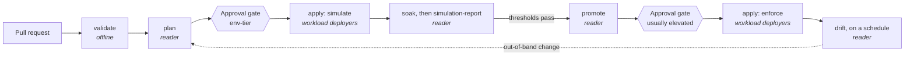

# Purview Policy Deployment Framework (PPDF)

Infrastructure as code for Microsoft Purview. Describe DLP policies, retention, custom sensitive information types
and role assignments in YAML. PPDF compares them with the tenant and produces a plan for a person to review. It
deploys changes in **simulation** first, measures what they would have done, and only **enforces** them after a
person approves the evidence. Every change is made by a **least-privilege identity for that workload**.

PPDF works with any orchestrator. The engine is a PowerShell module with a CLI, and orchestrators only decide when
to run it and who approves. Adapters are included for **GitHub Actions**, **Azure DevOps** and **Terraform**.

> [!IMPORTANT]
> Version 0.1 (Phase 1). Test in a non-production tenant first. Items marked **verify** in the docs (exact role
> names, service limits, preview features) are based on current Microsoft documentation; confirm them in your
> tenant before production use.

## Contents

- [What it manages](#what-it-manages)
- [How it works](#how-it-works)
- [Safety model](#safety-model)
- [Repository layout](#repository-layout)
- [Prerequisites](#prerequisites)
- [Quick start](#quick-start)
- [Setting up a deployment](#setting-up-a-deployment)
- [Identities](#identities)
- [Orchestrator adapters](#orchestrator-adapters)
- [Command reference](#command-reference)
- [Getting help](#getting-help)
- [Documentation](#documentation)
- [Development and testing](#development-and-testing)
- [Roadmap](#roadmap)
- [License](#license)

## What it manages

| Kind | Workload | How it is simulated |
|---|---|---|
| `DlpPolicy` (policy and rules) | dlp | Deployed in DLP test mode and measured in Activity Explorer. Changes to a live policy are tested in a shadow copy. |
| `RetentionPolicy` | retention | Deployed as an unlocked, keep-only equivalent, so nothing is deleted while simulating, and checked for distribution errors. |
| `RetentionLabel` | retention | Inert until a policy uses it. |
| `RetentionLabelPolicy` | retention | What-if: the plan is the preview. |
| `SensitiveInfoTypeRulePackage` (custom SITs) | classifier | Uploaded (a new SIT does nothing until a policy uses it), then tested against a labelled corpus of sample text for precision and recall. |
| `RoleGroup` (Purview role groups) | rbac | What-if. |
| `EntraRoleAssignment` (PIM-eligible or active Entra roles) | rbac | What-if, within an allowlist. |

Run `pwsh ./cli/ppdf.ps1 kinds` for the current list. See the [roadmap](#roadmap) for what comes next.

## How it works



1. **Validate.** Schemas, references, variables and guardrails are checked offline on every pull request.
2. **Plan.** The reader identity compares config with the tenant and writes `plan.json`, its hash
   (`plan.json.sha256`) and a readable `plan.md`. Every action gets an approval tier, and the plan names the gate
   that must approve it, for example `prod-standard`.
3. **Approve.** A person approves that plan hash at the named gate (a GitHub environment, an Azure DevOps
   environment check or a Terraform pull request).
4. **Apply at the simulate stage.** Each workload's deployer applies only its own actions, in test mode.
5. **Query the simulation.** After a soak period, `simulation-report` measures what each simulated policy would
   have done (DLP matches per day, retention distribution errors, SIT precision and recall) and compares it with
   thresholds. You can query the same data yourself (see
   [querying simulation results](docs/lifecycle.md#querying-simulation-results)).
6. **Promote.** A plan to enforce is only produced for artifacts whose report shows `pass` *for exactly the same
   config*. It is approved and applied like any other plan.
7. **Operate.** Drift detection runs on a schedule. Rollback builds the reverse of a previous apply. Export brings
   existing tenant configuration under management.

The full lifecycle is in [docs/lifecycle.md](docs/lifecycle.md).

## Safety model

- **Human in the loop.** Nothing changes the tenant without an approved plan. Approval tiers (`low`, `standard`,
  `elevated`, `critical`) route riskier changes, such as enforcing, deleting, skipping simulation or privileged
  roles, to more senior approvers.
- **Approve exactly what you saw.** Apply verifies the plan hash, refuses a plan that is older than
  `approvals.maxPlanAgeHours` or needs a higher tier than the gate that approved it, and re-reads each object
  before changing it. If the tenant changed since the plan, that workload is skipped as stale.
- **Simulation before enforcement.** Enforcement needs passing evidence that is bound to the artifact's hash.
  Change the artifact and the evidence no longer counts.
- **Ownership.** PPDF tags every object it manages and never changes an object without its tag. Existing objects
  must be explicitly adopted, and deleting objects needs `critical` approval and an explicit opt-in.
- **Blocked actions.** Unsafe actions (for example a Preservation Lock without acknowledgement, or changing an
  immutable label property) are blocked at plan time and cannot be approved at any tier.
- **Least privilege.** Planning, reporting and drift detection run as a read-only identity. Each workload deploys
  with its own identity, and those identities only get a token inside an approved job.
- **Evidence.** Every apply produces an evidence bundle (plan, hashes, simulation report, results and logs) for
  audit and rollback.

## Repository layout

```text
src/PurviewIaC/          PowerShell module: engine, providers per workload, public commands, help
cli/ppdf.ps1             CLI wrapper used by every pipeline
schemas/                 JSON Schemas for environment and artifact files (use them in your editor)
examples/contoso/        A complete example configuration: 4 environments, DLP, retention, SIT, RBAC
identities/              Creating the least-privilege identities: Terraform, PowerShell, Entra Agent ID
.github/                 Reusable GitHub workflows (ppdf-plan, ppdf-apply) and the setup-ppdf action
pipelines/github/        Example GitHub caller workflows for a configuration repository
pipelines/azure-devops/  Azure DevOps templates and example pipelines
pipelines/terraform/     Terraform module that runs PPDF (Terraform Cloud/HCP or any backend)
docs/                    Configuration, lifecycle, architecture, identities, adapters, runbooks
tests/                   Pester tests
```

Your own configuration normally lives in a separate repository that calls this one:

```text
config/
  environments/<env>.yml      one per tenant or ring: tenant, identities, approvals, thresholds
  artifacts/**/<name>.yml     one per Purview object, in any folder layout
```

## Prerequisites

| Requirement | Needed for |
|---|---|
| PowerShell 7.4 or later | Everything |
| [powershell-yaml](https://www.powershellgallery.com/packages/powershell-yaml) (or `PPDF_YAMLDOTNET_PATH`) | Reading YAML config (not needed for JSON config) |
| ExchangeOnlineManagement 3.8 or later | Commands that connect to the tenant (Security & Compliance PowerShell). 3.8 adds the access-token sign-in used by federated identities. |
| Microsoft.Graph.Authentication 2.x | `EntraRoleAssignment` artifacts |
| Entra ID and Purview admin rights, once | Creating the identities and their role groups |

`validate`, `rollback` and `kinds` work offline and only need PowerShell and powershell-yaml.

```powershell
Install-Module powershell-yaml, ExchangeOnlineManagement, Microsoft.Graph.Authentication -Scope CurrentUser
```

## Quick start

Try it offline with the example configuration:

```powershell
git clone https://github.com/therealtadda/purview-policy-deployment-framework.git
cd purview-policy-deployment-framework

pwsh ./cli/ppdf.ps1 kinds                                     # supported kinds and simulation strategies
pwsh ./cli/ppdf.ps1 validate -ConfigRoot ./examples/contoso   # schema, references and guardrails
```

Then plan against a test tenant with your own session. Plan is read-only:

```powershell
Import-Module ./src/PurviewIaC/PurviewIaC.psd1
Connect-IPPSSession -UserPrincipalName admin@contoso.onmicrosoft.com
Connect-MgGraph -Scopes RoleManagement.Read.Directory     # only for EntraRoleAssignment artifacts

# Copy examples/contoso to ./config and set your tenant in config/environments/dev.yml first.
Invoke-PpdfPlan -Environment dev -Stage simulate -UseExistingConnection -OutputPath ./out/dev
Get-Content ./out/dev/plan.md
```

Add `-Workload dlp,retention` to plan only some workloads. Your account needs at least the reader's view-only
roles.

To onboard a tenant that already has policies, start with `Invoke-PpdfExport`; see
[Adopt existing configuration](docs/runbooks.md#adopt-existing-brownfield-configuration).

## Setting up a deployment

1. **Create a configuration repository** with `config/environments` and `config/artifacts`. Start from
   [examples/contoso](examples/contoso) and the [configuration reference](docs/configuration.md).
2. **Create the identities**: one read-only reader and one deployer per workload, with federated credentials
   that only work behind your approval gates. See [Identities](#identities).
3. **Grant Purview roles** with `identities/powershell/Grant-PpdfPurviewRoles.ps1`. Each identity is added to its
   own least-privilege role group, never a built-in admin group.
4. **Create the approval gates** (`<env>-read` and `<env>-<tier>`) in your orchestrator, with the right
   reviewers for each tier.
5. **Copy the example pipelines** for your orchestrator and pin them to a release.
6. **Run the first deployment.** Follow [First deployment](docs/runbooks.md#first-deployment-to-a-new-environment).

## Identities

| Role | Does | Purview permissions |
|---|---|---|
| `reader` | plan, simulation-report, promote, drift, export | View-only compliance roles |
| `dlp` | Applies `DlpPolicy` | DLP Compliance Management |
| `retention` | Applies retention kinds | Retention Management (Record Management only if needed) |
| `classifier` | Applies SIT rule packages | Custom SIT management |
| `rbac` | Applies `RoleGroup` and `EntraRoleAssignment` | Role Management, plus PIM via Graph |

Which identity type to use:

| Type | Best for |
|---|---|
| App registration with workload identity federation | GitHub Actions, Azure DevOps, Terraform Cloud/HCP. No secrets, and the trust is pinned to the repo, environment or workspace. |
| App trusting a user-assigned managed identity | Self-hosted runners or agents on Azure, Automation, Functions. |
| App with a certificate in Key Vault | On-premises or other clouds without OIDC. |
| Entra Agent ID (preview) | Autonomous agents that analyse simulation results or triage drift. They read and propose changes by pull request, never deploy. |
| User account with PIM | People: local testing, exports, break-glass. |

Ready-made examples:

- [identities/terraform](identities/terraform): GitHub, Azure DevOps and Terraform Cloud.
- [identities/powershell](identities/powershell): `New-PpdfIdentities.ps1` and `Grant-PpdfPurviewRoles.ps1`.
- [identities/agent-id](identities/agent-id): Entra Agent ID.

The reasoning and the permission matrix are in [docs/identities.md](docs/identities.md) and
[identities/roles-matrix.yml](identities/roles-matrix.yml).

## Orchestrator adapters

| Orchestrator | Where | Approval gate | Notes |
|---|---|---|---|
| GitHub Actions | [.github/workflows](.github/workflows), [pipelines/github](pipelines/github) | GitHub environments `{env}-{tier}` with required reviewers | Reusable plan and apply workflows; PR validation, ring rollout, scheduled report and drift issue; rollback by run ID. |
| Azure DevOps | [pipelines/azure-devops](pipelines/azure-devops) | Environments with approvals and checks | Stage templates for plan and apply; one WIF service connection per identity. |
| Terraform | [pipelines/terraform](pipelines/terraform) | `approved_tier`, changed by a reviewed pull request, plus run approval | Runs PPDF from `terraform plan`/`apply`; for Terraform Cloud/HCP or any backend. |

Every adapter follows the same contract: plan as the reader, pass the exact plan file to apply, choose the gate
from the plan's `approval_environment`, and apply with `-ExpectedPlanHash` and `-ApprovedTier`. To support
another orchestrator (Jenkins, GitLab and so on), see
[Building an adapter](docs/adapters.md#building-an-adapter-for-another-orchestrator).

## Command reference

| CLI command | Module function | Identity | What it does |
|---|---|---|---|
| `validate` | `Invoke-PpdfValidate` | none (offline) | Checks config against schemas and rules |
| `plan` | `Invoke-PpdfPlan` | reader | Compares config with the tenant; writes `plan.json` and `plan.md` |
| `apply` | `Invoke-PpdfApply` | workload deployers | Applies an approved plan |
| `simulation-report` | `Invoke-PpdfSimulationReport` | reader | Measures simulation results against thresholds |
| `promote` | `Invoke-PpdfPromote` | reader | Plans simulate → enforce for artifacts that pass |
| `drift` | `Invoke-PpdfDrift` | reader | Finds changes made outside PPDF |
| `export` | `Invoke-PpdfExport` | reader | Writes existing tenant config as artifact files |
| `rollback` | `Invoke-PpdfRollback` | none (offline) | Builds a plan that undoes a previous apply |
| `kinds` | `Get-PpdfKind` | none (offline) | Lists supported artifact kinds |

**Exit codes** (all commands):

| Code | Meaning |
|---|---|
| `0` | Success, nothing pending. |
| `2` | Success, with changes to review (plan, promote, rollback) or drift detected. |
| `3` | Stopped by a safety gate: blocked actions, apply refused or stale, or simulation not passing. |
| `1` | Error: invalid config, sign-in failure or cmdlet failure. See `<OutputPath>/ppdf-<command>.log.jsonl`. |

**Output files** in `-OutputPath` (default `./out`): `plan.json`, `plan.md`, `simulation-report.json/.md`,
`drift.json/.md`, `rollback-plan.json/.md`, `apply-result.json/.md`, an `evidence/` bundle, `.sha256` sidecars
and a JSON-lines run log.

**Pipeline outputs.** In GitHub Actions and Azure DevOps each command also sets outputs: `plan_path`,
`plan_hash`, `has_changes`, `blocked`, `approval_tier`, `approval_environment`, `workloads`, `sim_report_path`,
`sim_report_hash`, `sim_pass`, `apply_result_path`, `evidence_path`, `drift_detected` and `ppdf_exit_code`.

**Environment variables:**

| Variable | Purpose |
|---|---|
| `PPDF_CONFIG_ROOT` | Default for `-ConfigRoot` (otherwise `./config`). |
| `PPDF_SKIP_CONNECT` | `1` reuses the current session, like `-UseExistingConnection`. |
| `PPDF_SCHEMA_PATH` | Folder containing the JSON Schemas, if not next to the module. |
| `PPDF_YAMLDOTNET_PATH` | `YamlDotNet.dll` to use when powershell-yaml isn't installed. |
| `PPDF_FEDERATED_TOKEN` | A federated token from any orchestrator. |
| `PPDF_CERT_THUMBPRINT`, `PPDF_CERT_PATH`, `PPDF_CERT_PASSWORD` | Certificate sign-in. |
| `PPDF_MODULE_PATH` | CLI only: the module manifest to import. |
| `PPDF_RESULT_PATH` | CLI only: also write the result object as JSON to this file. |

## Getting help

All commands and scripts have full help for operators: what they do, which identity they need, every parameter,
exit codes and worked examples.

```powershell
Import-Module ./src/PurviewIaC/PurviewIaC.psd1
Get-Help about_PurviewIaC                     # concepts: lifecycle, tiers, identities, ownership, exit codes
Get-Help Invoke-PpdfPlan -Full                # one command, with examples
Get-Command -Module PurviewIaC                # all commands

pwsh ./cli/ppdf.ps1 help                      # CLI overview
pwsh ./cli/ppdf.ps1 help promote              # full help for one CLI command
Get-Help ./identities/powershell/Grant-PpdfPurviewRoles.ps1 -Full
```

If your execution policy blocks downloaded scripts, have them signed or allow them according to your
organisation's policy; don't bypass it.

## Documentation

| Document | Contents |
|---|---|
| [docs/configuration.md](docs/configuration.md) | Environment and artifact files, every field, variables, ownership tags |
| [docs/lifecycle.md](docs/lifecycle.md) | Stages, simulation strategies, thresholds, report statuses, tiers, blocked actions, drift, rollback |
| [docs/runbooks.md](docs/runbooks.md) | Step-by-step procedures: onboarding, first deployment, promote, failures, rollback, drift, rotation, removal |
| [docs/identities.md](docs/identities.md) | Identity types, federated credential subjects, permissions, certificates, provisioning order |
| [docs/adapters.md](docs/adapters.md) | The adapter contract; GitHub, Azure DevOps and Terraform setup and inputs |
| [docs/architecture.md](docs/architecture.md) | How the engine, providers, plans and evidence fit together; extending PPDF with new kinds |
| [identities/README.md](identities/README.md) | Creating the identities |
| [pipelines/terraform/README.md](pipelines/terraform/README.md) | The Terraform adapter |

## Development and testing

```powershell
Install-Module Pester -MinimumVersion 5.5 -Scope CurrentUser
Install-Module PSScriptAnalyzer -Scope CurrentUser

Invoke-Pester ./tests                                              # unit tests (no tenant needed)
Invoke-ScriptAnalyzer -Path ./src, ./cli, ./identities -Recurse -Settings ./PSScriptAnalyzerSettings.psd1
```

The [CI workflow](.github/workflows/ci.yml) runs both, validates the example configuration and checks the
Terraform formatting on every pull request.

New kinds are added as providers; see [docs/architecture.md](docs/architecture.md). Keep the help in step with
the code: every public function and script has comment-based help with examples.

## Roadmap

| Phase | Scope |
|---|---|
| 1 (this release) | Engine, CLI, DLP, retention, custom SITs, role groups, Entra roles, export, drift, rollback, GitHub/ADO/Terraform adapters, identity examples |
| 2 | Exact Data Match (EDM), Insider Risk Management policies, sensitivity labels and auto-labelling |
| 3 | Trainable classifiers, DSPM, Insider Risk Management settings, runnable agents |

## License

[BSD 3-Clause](LICENSE).
