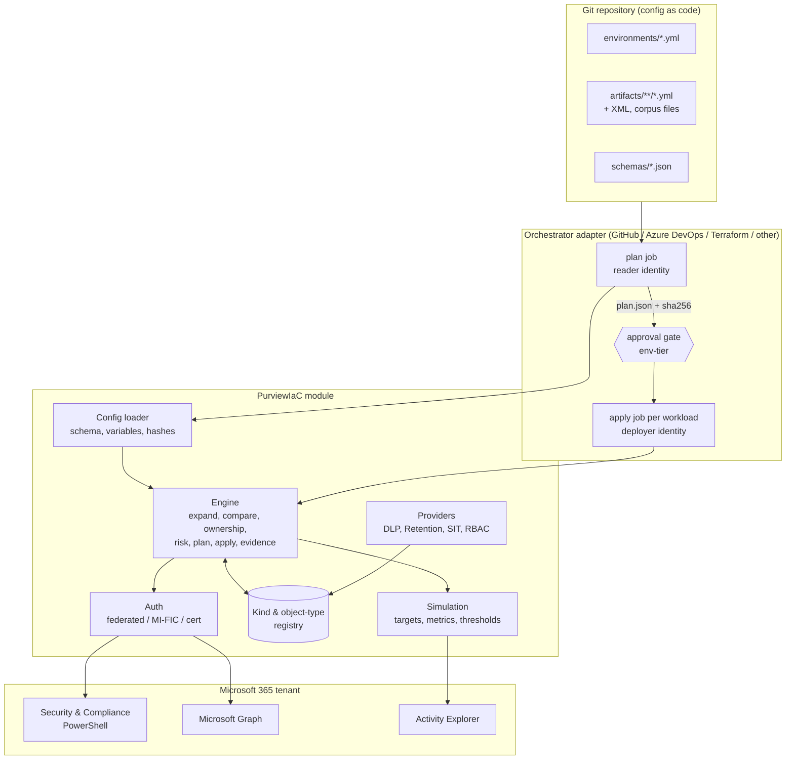

# Architecture

PPDF is a PowerShell 7 module (`PurviewIaC`) with a thin CLI (`cli/ppdf.ps1`). All of the logic (config
loading, planning, simulation, risk assessment, apply and evidence) lives in the module. Orchestrators (GitHub
Actions, Azure DevOps, Terraform, or anything else) only run CLI commands, carry files between jobs, and put a
human approval gate in front of `apply`. They hold no Purview logic, so the same plan produces the same result on
any platform.



## Components

| Path | Responsibility |
|---|---|
| `src/PurviewIaC/Public/` | The 9 public commands (one file each), with full comment-based help. |
| `src/PurviewIaC/Private/Config.ps1` | Loads environment and artifacts, validates against JSON Schema, resolves `${variables}`, applies ring and simulation location overrides, and computes artifact hashes. |
| `src/PurviewIaC/Private/Engine.ps1` | Builds plans (expand → read current state → ownership → diff → risk), checks simulation evidence, finds orphans, applies plans with freshness checks, and writes the evidence bundle. |
| `src/PurviewIaC/Private/Simulation.ps1` | Finds what was deployed in simulation for each artifact, collects metrics, evaluates thresholds and builds the simulation report. |
| `src/PurviewIaC/Private/Compare.ps1` | Normalised comparison of desired and current state (only properties the config sets are compared). |
| `src/PurviewIaC/Private/Common.ps1` | Canonical hashing, ownership tags, approval tiers and shared helpers. |
| `src/PurviewIaC/Private/Auth.ps1` | Signs in as the purpose-specific identity for a role (Security & Compliance PowerShell and/or Graph). |
| `src/PurviewIaC/Private/Commands.ps1` | Shared command plumbing: plan and simulation-report writers, exit-code rules, document integrity checks. |
| `src/PurviewIaC/Private/Logging.ps1` | Orchestrator detection, structured JSON-lines run log, step outputs and job summaries. |
| `src/PurviewIaC/Private/Invoke.ps1` | Wrappers around Security & Compliance cmdlets and Graph calls (the only place the tenant is called). |
| `src/PurviewIaC/Private/ProviderHelpers.ps1` | Helpers for providers: cmdlet parameter building, tagged-object listing, Activity Explorer queries, export documents. |
| `src/PurviewIaC/Private/Registry.ps1` | `Register-PpdfKind`, `Register-PpdfObjectType`, `New-PpdfDesiredObject`. |
| `src/PurviewIaC/Providers/` | One file per workload: registers its kinds and object types. |
| `schemas/` | JSON Schemas for the environment, the artifact envelope and each kind (`schemas/kinds/<Kind>.schema.json`). Also usable in editors for autocomplete. |
| `cli/ppdf.ps1` | CLI wrapper: argument parsing, help, exit codes, `PPDF_RESULT_PATH`. |
| `pipelines/` | Orchestrator adapters (see [adapters.md](adapters.md)). |
| `identities/` | Terraform module, PowerShell scripts and guidance for the least-privilege identities (see [identities.md](identities.md)). |

## Kinds and object types

A **kind** is what authors write (`kind: DlpPolicy`). An **object type** is what exists in the tenant
(`DlpCompliancePolicy`, `DlpComplianceRule`). A kind's `Expand` turns one artifact into one or more desired
objects. Exactly one of them is the *primary* object, which carries the ownership tag and determines the artifact's
current stage.

| Kind | Object types | Identity role | Strategy |
|---|---|---|---|
| DlpPolicy | DlpCompliancePolicy (primary), DlpComplianceRule | dlp | mode (+ shadow) |
| RetentionPolicy | RetentionCompliancePolicy (primary), RetentionComplianceRule | retention | mode |
| RetentionLabel | ComplianceTag | retention | none |
| RetentionLabelPolicy | RetentionCompliancePolicy, RetentionComplianceRule | retention | whatif |
| SensitiveInfoTypeRulePackage | SitRulePackage | classifier | corpus |
| RoleGroup | RoleGroup (roles and members), or RoleGroupMembership when `membershipOnly: true` | rbac | whatif |
| EntraRoleAssignment | EntraRoleAssignment (Graph PIM) | rbac | whatif |

`Get-PpdfKind` lists the registered kinds and their capabilities at runtime.

## Plan pipeline

For each artifact, `Build-PpdfPlan` does the following:

1. Picks the stage: the requested one, or for `auto` the stage in the primary object's current tag.
2. Calls the kind's `Expand` to produce the desired objects for that stage. Simulate-stage expansions produce
   test-mode or keep-only equivalents, or a `-ppdfsim` shadow copy.
3. Reads current state with each object type's `Get`.
4. Decides ownership from the tag: *absent*, *managed* (tag id matches), *foreign* (tagged by another artifact:
   blocked), or *unmanaged* (exists without a tag: `adopt`, blocked unless `metadata.adopt: true`).
5. Compares desired with current (only keys the config sets) and emits `create`, `update`, `adopt` or `noop`
   actions. A managed primary whose tag hash or stage differs is re-stamped.
6. Assesses risk: base tiers, then `metadata.riskTier`, then the kind's `Assess`, then the simulation-evidence gate
   for enforce-stage kinds that require it.

Then it finds orphans (via each object type's `ListManaged`) and `ensure: absent` deletes. The plan's required
tier is the maximum tier over all its actions. See [lifecycle.md](lifecycle.md#approval-tiers) for the tier
rules.

Each action records the identity role, the desired properties, the current values (`expected`), a fingerprint of
current state and the diff keys. Apply uses these for freshness checks and rollback uses them to restore previous
values.

## Ownership tags

PPDF never relies on names alone to decide what it owns. Each managed object carries a tag appended to a
free-text property (`Comment` for DLP and retention objects and labels, `Description` for role groups):

```
[ppdf:v1 id=DlpPolicy/PPDF-Finance-PCI sha=1a2b3c4d stage=simulate ts=2025-01-31T09:00:00Z]
```

| Field | Use |
|---|---|
| `id` | Owning artifact (`Kind/name`). Detects foreign and orphaned objects. A shadow copy uses `<id>#sim`. |
| `sha` | First 8 hex characters of the artifact hash. Simulation evidence is only valid for the same sha. |
| `stage` | `simulate` or `enforce`. Used by `-Stage auto`, drift and simulation reporting. |
| `ts` | When this version and stage was deployed. Soak time and DLP match windows start here. |

SIT rule packages, role-group memberships and Entra role assignments have no free-text property. Their ownership
comes from the parent artifact, and they are never orphan-detected.

## Integrity and evidence

- **Artifact hash**: SHA-256 over the canonical JSON of the resolved artifact plus the hashes of every file it
  references (rule-pack XML, corpus). Key order and formatting do not change it.
- **Config hash**: hash over all artifact hashes plus the environment, recorded in plans and reports.
- **Document sidecars**: `plan.json`, `drift.json`, `rollback-plan.json`, `apply-result.json` and
  `simulation-report.json` each get a `.sha256` file. Every command that reads one of these documents checks the
  sidecar first.
- **Approval binding**: the pipelines pass the plan hash shown to the approver (`plan_hash` output) to apply as
  `-ExpectedPlanHash`, and the gate's tier as `-ApprovedTier`.
- **Evidence bundle**: apply copies the plan, plan.md, simulation report, apply result and run log to
  `evidence/` with a `manifest.json` of SHA-256 hashes.

## Identity separation

Commands that only read run as the `reader` identity. `apply` groups actions by the kind's identity role and signs
in as `dlp`, `retention`, `classifier` or `rbac` for that group only. The pipelines go further and run one apply
job per workload, with only that workload's service connection or federated credential available. Supported
sign-in modes:

| `authMode` | Credential | Used for |
|---|---|---|
| `federated` (default) | Orchestrator OIDC token: GitHub, Azure DevOps service connection, Terraform Cloud, `AZURE_FEDERATED_TOKEN_FILE` or `PPDF_FEDERATED_TOKEN` | Hosted runners. No secrets. |
| `managedidentity-fic` | Managed identity token used as a federated credential for the app | Self-hosted runners on Azure. |
| `certificate` | Certificate thumbprint or PFX (`PPDF_CERT_*`) | Platforms without OIDC. |
| `interactive` | The operator's own sign-in | Local lab use only. |

See [identities.md](identities.md) for the roles each identity needs and how to choose between them.

## Extending PPDF with a new kind

Phase 2 and 3 workloads (EDM, IRM, sensitivity labels, DSPM) are added the same way as the Phase 1 providers:

1. Add `src/PurviewIaC/Providers/<Workload>.ps1`. The module dot-sources every file in `Providers/` at import.
2. Register each tenant object type:

   ```powershell
   Register-PpdfObjectType -Name 'MyObject' -Workload 'myworkload' -TagProperty 'Comment' -Service 'scc' `
       -KnownProperties @('Comment', 'Enabled') `
       -Get { param($Desired, $Context) <# return normalized current state as a dictionary, or $null #> } `
       -ListManaged { param($Context) <# return all tagged objects (for orphan detection) #> } `
       -Create { param($Desired, $Context) } `
       -Update { param($Desired, $Current, $DiffKeys, $Context) } `
       -Remove { param($Desired, $Current, $Context) }
   ```

3. Register the kind:

   ```powershell
   Register-PpdfKind -Name 'MyKind' -Workload 'myworkload' -IdentityRole 'myrole' -SimulationStrategy 'mode' `
       -RequiresSimulationEvidence $true -DefaultThresholds @{ requireDistributionSuccess = $true } `
       -Description 'One line shown by Get-PpdfKind.' `
       -Expand { param($Artifact, $Context, $Stage, $Shadow)
           New-PpdfDesiredObject -Type 'MyObject' -Name $Artifact.Name -Order 10 -Primary -Properties ([ordered]@{ Enabled = ($Stage -eq 'enforce') })
       } `
       -Validate { param($Artifact, $EnvSpec) <# return error strings #> } `
       -Assess { param($Action, $Artifact, $Context) <# return @{ Tier; Reason; Block } entries #> } `
       -SimulationResult { param($Artifact, $Context, $Target) <# return a metrics dictionary #> } `
       -Export { param($Context) <# return @{ Name; Doc; Files } per existing object #> }
   ```

4. Add `schemas/kinds/MyKind.schema.json` and an example under `examples/`.
5. Add the identity role to `identities/roles-matrix.yml`, the Terraform module and the pipeline service
   connections, following the least-privilege pattern in [identities.md](identities.md).
6. Add unit tests under `tests/unit/`.

`Order` controls apply order (lower first for create/update, reverse for deletes). `Parent` links child objects
to their parent. `Options` passes create-only parameters that are not compared.
