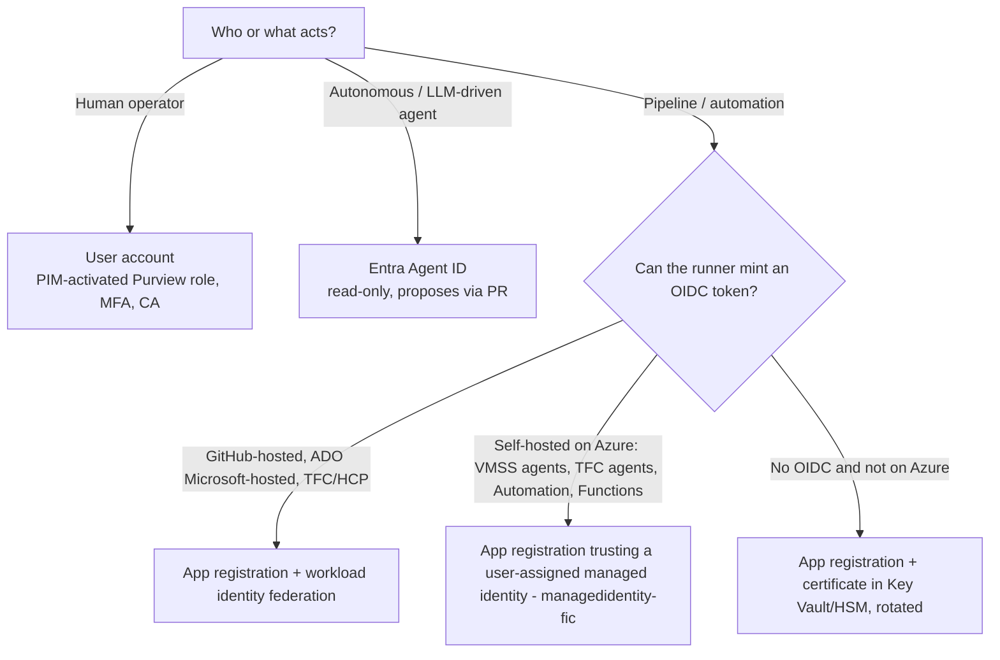

# Identities and least privilege

PPDF never deploys as a person or as a broadly privileged account. Each operation runs as a **purpose-specific
workload identity** that holds only the permissions that operation needs. The engine selects the identity per action:

- `validate`, `plan`, `simulation-report`, `drift` and `export` run as **reader**.
- `apply`, `promote` and `rollback` group the plan's actions by `identityRole` (`dlp`, `retention`, `classifier`,
  `rbac`) and connect once per group with that deployer.

Identities are declared per environment in `spec.identities`:

```yaml
spec:
  identities:
    reader:     { clientId: 00000000-0000-0000-0000-000000000001 }           # authMode defaults to federated
    dlp:        { clientId: 00000000-0000-0000-0000-000000000002 }
    retention:  { clientId: 00000000-0000-0000-0000-000000000003, authMode: managedidentity-fic, managedIdentityClientId: 00000000-0000-0000-0000-0000000000a3 }
    rbac:       { clientId: 00000000-0000-0000-0000-000000000005, authMode: certificate, certificateThumbprint: ABCDEF0123456789ABCDEF0123456789ABCDEF01 }
```

The full matrix of operations, roles and permissions is in [`identities/roles-matrix.yml`](../identities/roles-matrix.yml).

## Choosing an identity type



| Type | Use when | Why | Avoid when |
|---|---|---|---|
| **App registration + workload identity federation** (`federated`) | GitHub Actions, Azure DevOps (WIF service connections), Terraform Cloud/HCP | No secrets. The trust is pinned to the repo and environment, the service connection, or the workspace and run phase, so a token exists only after the orchestrator's approval gate. | The runner cannot get an OIDC token |
| **App + managed identity as a federated credential** (`managedidentity-fic`) | Self-hosted runners and agents on Azure, Azure Automation, Functions | No secrets, and the credential cannot leave the Azure resource. `Connect-IPPSSession` has no `-ManagedIdentity`, so the managed identity token is exchanged for the app's token. | Several unrelated workloads share the host (they would share the managed identity) |
| **App + certificate** (`certificate`) | On-premises or other clouds without OIDC; break-glass automation | Works everywhere. Keep the certificate non-exportable in Key Vault or an HSM, rotate it at most every 6–12 months, and alert on use. | Any OIDC option is available |
| **Entra Agent ID** | Autonomous agents: simulation analysis, drift triage | Has sponsors, agent-specific Conditional Access and governance, and one blueprint credential for many agents. PPDF agents are read-only and **propose** by pull request. See [`identities/agent-id`](../identities/agent-id/README.md). Preview. | Deterministic pipeline deployers; use workload identities for those |
| **User** (`interactive`) | Local development against a dev tenant; one-off administration | A human is accountable and protected by MFA, Conditional Access and PIM | Any automated or production deployment |
| ~~Client secret~~ | Never | It can leak and is easy to copy | — |

## Federated credential subjects

The Terraform module (`identities/terraform/modules/ppdf-identities`) builds these from typed inputs:

| Orchestrator | Issuer | Subject | Notes |
|---|---|---|---|
| GitHub Actions | `https://token.actions.githubusercontent.com` | `repo:<owner>/<repo>:environment:<env>` | Bind to **environments**, not branches, so required reviewers gate token issuance. |
| Azure DevOps | `https://login.microsoftonline.com/<tenant-id>/v2.0` (Microsoft Entra issuer, the default for new connections) | Generated by ADO. Copy it from the draft service connection (`ado_subjects` in the Terraform example). | One WIF service connection per identity. Put approvals and checks on the service connection **and** the environment. The legacy `vstoken.dev.azure.com` issuer with `sc://<org>/<project>/<sc>` is deprecated and retires on 2027-07-01. Use `ado_issuer_mode = "legacy"` only until you convert. |
| Terraform Cloud / HCP | `https://app.terraform.io` | `organization:<o>:project:<p>:workspace:<w>:run_phase:<plan\|apply>` | Reader trusts `plan`; deployers trust `apply`. Set `TFC_WORKLOAD_IDENTITY_AUDIENCE=api://AzureADTokenExchange`. |
| Managed identity | `https://login.microsoftonline.com/<tenant-id>/v2.0` | managed identity principal (object) ID | Used by `managedidentity-fic`. |

Audience is always `api://AzureADTokenExchange`. Entra allows at most **20 federated credentials per app**.

### Approval tiers and GitHub environments

Every plan is classified into a tier (`low`, `standard`, `elevated`, `critical`). The tier depends on the blast radius:
action type, workload, mode change (simulate → enforce), deletions and RBAC changes. The plan outputs
`approval_environment`, built from `approvals.pattern` (default `{env}-{tier}`) or `approvals.environments.<tier>`.

A GitHub job runs in exactly one environment, and its OIDC subject contains that environment's name. Each deployer
therefore trusts all four tier environments of its approval prefix (4 credentials per prefix). The reader trusts
only `<prefix>-read`, which has no reviewers. Configure each tier environment with escalating required reviewers,
**prevent self-review** and deployment branch rules (`main` only).

## Purview permissions

Entra permissions alone grant nothing in Purview. `Exchange.ManageAsApp` only lets the app connect to Security &
Compliance PowerShell. Every Purview permission comes from **custom role group** membership, which
`identities/powershell/Grant-PpdfPurviewRoles.ps1` creates. Terraform has no provider for these role groups.

Rules:

- One custom role group per identity, `<PREFIX>_<ROLE>`, holding only the roles in the matrix.
- Never use Compliance Administrator, Organization Management or other built-in groups.
- Graph application permissions are limited to the PIM schedule APIs, and only the `rbac` identity can write.
  The RBAC provider also enforces `guardrails.entraRoleAllowlist` and `entraPrincipalAllowlist`.

## Certificate setup (when no OIDC is available)

1. Create a non-exportable certificate in Key Vault, RSA 2048 or larger, with a 6–12 month lifetime and auto-renewal.
2. Upload only the public key to the app registration (`az ad app credential reset --cert ... --append`). Remove
   expired keys.
3. On the runner, read the certificate from the local machine store (`certificateThumbprint`), or set
   `PPDF_CERT_PATH` and `PPDF_CERT_PASSWORD` from the pipeline's secret store.
4. Alert on sign-ins from unexpected IP addresses. Add a Conditional Access policy for workload identities
   (Workload Identities Premium) that restricts by location.

## Provisioning order

1. **Entra objects**: `identities/terraform/examples/<orchestrator>`, or `New-PpdfIdentities.ps1`. Run as Application
   Administrator plus a role that can grant application permissions.
2. **Purview role groups**: `Grant-PpdfPurviewRoles.ps1`. Run as a Purview admin with Role Management activated via PIM.
3. **Orchestrator objects**: GitHub environments and reviewers, ADO WIF service connections and environments with
   approvals, or TFC workspaces and run approvals. Use the approver groups output by the module.
4. **Environment file**: paste `terraform output environment_identities` into `spec.identities`.
5. **Smoke test**: run `ppdf plan` as reader. It must succeed, and apply must fail if run as reader.

## Items to verify in your tenant

These have not been confirmed in documentation. Each is marked `verify` in the roles matrix:

- The exact names and availability of `View-Only Manage Alerts`, `Data Classification List Viewer` and
  `View-Only Record Management` in your cloud.
- Whether the reader's view-only roles allow `Get-RoleGroup` and `Get-DlpSensitiveInformationTypeRulePackage`.
- The least role that allows SIT rule package management. PPDF assumes DLP Compliance Management.
- Whether `Add-RoleGroupMember` accepts the service principal object ID, and which `Get-RoleGroupMember` field
  holds it (`ExternalDirectoryObjectId`).
- Whether app-only PIM requests for privileged directory roles need more than the `RoleEligibilitySchedule` and
  `RoleAssignmentSchedule` permissions.
- The Entra Agent ID API surface, which is in preview.

Check a role's cmdlets with `Get-ManagementRoleEntry "<Role>\*"` in Security & Compliance PowerShell.
