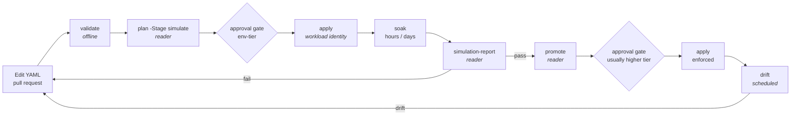

# Change lifecycle: plan, simulate, approve, promote, apply

Every change to a tenant follows the same path, whatever the orchestrator:



| Step | Command | Changes the tenant? | Output |
|---|---|---|---|
| Validate | `Invoke-PpdfValidate` | No (offline) | `validation.json` |
| Plan | `Invoke-PpdfPlan -Stage simulate\|enforce\|auto` | No | `plan.json` + `.sha256`, `plan.md` |
| Apply | `Invoke-PpdfApply` | **Yes** | `apply-result.*`, `evidence/` |
| Simulation report | `Invoke-PpdfSimulationReport` | No | `simulation-report.json` + `.sha256`, `.md` |
| Promote | `Invoke-PpdfPromote` | No (plans enforcement) | `plan.*` |
| Drift | `Invoke-PpdfDrift` | No | `drift.json` + `.sha256`, `drift.md` (a plan that restores config) |
| Rollback | `Invoke-PpdfRollback` | No (plans the inverse) | `rollback-plan.*` |

Only **apply** writes to Purview, and apply only runs a plan that a human approved. Every other command uses the
read-only identity or no identity at all.

---

## Stages

Every artifact is deployed at a *stage*, which is recorded in its ownership tag.

| Stage | Meaning |
|---|---|
| `simulate` | Deploy in a form that observes without affecting users (see strategies below). |
| `enforce` | Deploy as written in config (live). |
| `auto` | Keep each object at the stage it is already at. New objects go to `simulate`. An unmanaged object being adopted is treated as `enforce`, so adoption never downgrades a live policy to test mode. Use for dev tenants and for routine edits that should not change stage. |

`plan -Stage simulate` is the normal starting point. `promote` is `plan -Stage enforce` with simulation evidence
attached. You can run `plan -Stage enforce` directly, but kinds that need evidence are then blocked unless you pass
`-SimulationReportPath`.

## Simulation strategies

Each kind declares how it is simulated (`Get-PpdfKind` shows this):

| Strategy | Kinds | What the simulate stage does | Evidence collected by `simulation-report` |
|---|---|---|---|
| `mode` | DlpPolicy, RetentionPolicy | **DLP:** deploys the policy in a test mode: artifact `simulation.mode`, else environment `simulation.dlpMode`, else `TestWithoutNotifications`. **Retention:** deploys an *unlocked, keep-only* equivalent (deleting actions become keep-only, no Preservation Lock), so no content is ever deleted during simulation. | **DLP:** Activity Explorer `DLPRuleMatch` events since the tag timestamp, plus policy distribution status. **Retention:** distribution status and errors. |
| `corpus` | SensitiveInfoTypeRulePackage | Uploads the rule package. A new SIT has no effect until a policy references it. | Runs every case in `spec.testCorpusFile` through `Test-DataClassification`; computes precision, recall and false positives/negatives. |
| `whatif` | RetentionLabelPolicy, RoleGroup, EntraRoleAssignment | Nothing; the change is *deferred*. The plan still shows the what-if diff. | None. Reported as `deferred`; the change is gated by approval at the enforce stage. |
| `none` | RetentionLabel | Deployed directly (a label is inert until a policy publishes it). | Reported as `not-applicable`. |

### Already-enforced policies: shadow simulation

A live DLP policy is never switched back to test mode. When a change is made to an *enforced* DLP policy (or to an
existing unmanaged one), the simulate stage deploys a **shadow copy** named `<name>-ppdfsim` in test mode, with
the new configuration. The simulation report measures the shadow copy. Promoting applies the change to the real
policy and plans removal of the shadow copy (`standard` tier).

A live retention policy cannot be shadowed. Changes to it are *deferred* to the enforce stage and need `elevated`
approval.

### Narrowing the simulation

- `simulation.scope` on an artifact replaces the policy's locations at the simulate stage only, for example to
  simulate against one pilot mailbox or site.
- A ring environment (`spec.ring.locationOverrides`) narrows locations at every stage. See
  [configuration.md](configuration.md#specring).
- `simulation.skip: true` skips simulation. The artifact is deferred at the simulate stage, and promotion needs
  `critical` approval.

---

## Thresholds

`simulation-report` compares the collected metrics with thresholds. Threshold names follow a convention, so you can
add a threshold for any scalar metric without code changes:

| Threshold | Passes when |
|---|---|
| `maxX: n` | metric `x` ≤ n |
| `minX: n` | metric `x` ≥ n |
| `requireX: true` | metric `x` is `true` |

The metric name is the threshold name without the prefix, with its first letter lower-cased (`maxMatchesPerDay`
→ `matchesPerDay`). A threshold whose metric is not collected fails with "Metric 'x' unavailable", so a typo
cannot silently pass.

**Metrics by kind**

| Kind | Metrics |
|---|---|
| DlpPolicy | `totalMatches`, `matchesPerDay` (peak day), `distinctUsers`, `matchesPerRule` (busiest rule), `distributionSuccess`, `soakHours`; plus `ruleBreakdown` and `workloadBreakdown` for reviewers |
| RetentionPolicy | `distributionSuccess`, `distributionErrorCount`, `soakHours`; plus `distributionStatus` and `distributionErrors` |
| SensitiveInfoTypeRulePackage | `cases`, `truePositives`, `falsePositives`, `falseNegatives`, `precision`, `recall`, `soakHours`; plus per-case results |

**Defaults and precedence** (later wins):

1. Kind defaults: DLP and retention `requireDistributionSuccess: true`; SIT `minPrecision: 0.9`, `minRecall: 0.9`,
   `maxFalsePositives: 0`.
2. Environment `spec.simulation.thresholds.<Kind>`.
3. Environment `spec.simulation.minSoakHours` (mode kinds only), checked as `minSoakHours` against `soakHours`.
4. Artifact `simulation.thresholds`.

Example: production requires DLP policies to soak for a week and stay under 2,000 matches a day, but one noisy
policy is allowed more:

```yaml
# environments/prod.yml
simulation:
  minSoakHours: 168
  thresholds:
    DlpPolicy: { maxMatchesPerDay: 2000, maxDistinctUsers: 500 }
# artifacts/dlp/finance-pci.yml
simulation:
  thresholds: { maxMatchesPerDay: 5000 }
```

Activity Explorer data can lag by several hours (verify for your tenant), so set `minSoakHours` well above that lag.

## Simulation report statuses

| Status | Meaning | Blocks promotion? |
|---|---|---|
| `pass` | Deployed at the simulate stage from the current config, and every threshold passed. | No |
| `fail` | At least one threshold other than soak time failed. | **Yes** |
| `soaking` | Only `minSoakHours` failed; run the report again later. | **Yes** |
| `missing` | Not deployed in simulation (apply the simulate plan first). | **Yes** |
| `stale` | The deployed simulation was built from a different version of the artifact. Re-apply the simulate stage. | **Yes** |
| `already-enforced` | Config is already enforced; nothing to promote. | No |
| `deferred` | No simulation equivalent (what-if kinds, or a live policy that cannot be shadowed). | No, but needs `elevated` approval |
| `not-applicable` | `ensure: absent`, or a kind that needs no simulation. | No |
| `skipped` | `simulation.skip: true`. | No, but needs `critical` approval |

The report as a whole passes (exit 0, `sim_pass=true`) when every artifact is `pass`, `already-enforced`,
`deferred`, `not-applicable` or `skipped`. Otherwise it exits 3.

Simulation evidence is bound to config. Each report entry records the artifact hash, and promote blocks any
artifact whose hash differs from the report (it was edited after simulation). The report must also be for the
same environment, match its `.sha256` sidecar, and be younger than `simulation.maxReportAgeHours` (default 168).

### Querying simulation results

Simulation results are plain JSON, so you can query them before going live:

```powershell
$r = Invoke-PpdfSimulationReport -Environment prod -OutputPath ./out/sim
$r.Report.artifacts | Format-Table id, status, soakHours
$r.Report.artifacts | Where-Object status -ne 'pass' | Select-Object id, status, notes
($r.Report.artifacts | Where-Object id -eq 'DlpPolicy/PPDF-Finance-PCI').metrics.ruleBreakdown
($r.Report.artifacts | Where-Object kind -eq 'SensitiveInfoTypeRulePackage').metrics.caseResults | Where-Object { -not $_.pass }
```

`simulation-report.md` is the same data formatted for a pull request, job summary or approval comment. The
scheduled example pipelines produce it daily.

---

## Approval tiers

Every planned action gets a risk tier. The plan's **required approval tier** is the highest tier of any action,
and the plan names the orchestrator gate that must approve it (`approvals.pattern`, default `{env}-{tier}`, for
example `prod-elevated`).

| Tier | Typical changes |
|---|---|
| `low` | No changes (empty plan). |
| `standard` | Create or update at the simulate stage; remove a shadow copy. |
| `elevated` | Enforce a DLP or retention change; adopt an existing object; delete a child rule; any role-group or Entra role change; change or disable the scope of an enforced DLP policy; remove locations from a retention policy; change SIT detection logic; auto-apply a retention label; deferred (unsimulated) changes; every rollback. |
| `critical` | Delete a top-level object; shorten retention or switch to a deleting action; create a deleting retention rule; Preservation Lock; record or regulatory labels; privileged Entra roles or permanent active assignments; sensitive Purview roles; promote with `simulation.skip`. |

`metadata.riskTier` on an artifact raises the minimum tier for all its changes. Each action lists the reasons for
its tier in `plan.md`, so approvers can see why a gate was chosen.

Configure the gates so that higher tiers have more, or more senior, reviewers. The pipelines pass the tier of the
gate that approved the job to apply as `-ApprovedTier`, and **apply refuses a plan whose required tier is higher**.
A misconfigured pipeline therefore cannot apply a critical change after a standard approval.

## Blocked actions

Some actions are blocked outright. A plan with any blocked action cannot be applied at any tier; fix the cause
and plan again. `plan.md` lists every blocked action with its reason, and the plan exits 3.

| Reason | Fix |
|---|---|
| Object exists but is not managed by PPDF | Confirm it is the same object, then set `metadata.adopt: true` (see [runbooks](runbooks.md#adopt-existing-brownfield-configuration)). |
| Object is owned by another artifact | Two artifacts declare the same object; rename one. |
| No valid simulation evidence / artifact changed since simulated / status not pass | Apply the simulate plan, wait for the soak, run `simulation-report`, then promote with that report. |
| Orphaned top-level object | Restore the artifact, or set `spec.allowDestructive: true`, or keep it with `metadata.ensure: absent`. |
| Preservation Lock not acknowledged | Set `spec.acknowledgeIrreversible: true` if this is really intended. |
| Cannot disable a policy with Preservation Lock | Not possible in Purview. |
| Retention label immutable property changed | Create a new label and move to it. |
| Role group roles changed in place | Create a new role group and migrate members. |
| SIT rule package changed without a Version bump, or Version goes backwards | Increment the `RulePack` `Version` in the XML. |

## Apply safety checks

Apply never re-plans. It runs exactly the actions in the approved `plan.json`, and refuses (exit 3, nothing
changed) when:

1. `plan.json` does not match its `.sha256` sidecar, or does not match `-ExpectedPlanHash` (the hash the approver
   saw);
2. the plan contains blocked actions;
3. `-ApprovedTier` is lower than the plan's required tier;
4. the plan is older than `approvals.maxPlanAgeHours` (default 24).

Actions are grouped by workload, and each group runs as that workload's identity only. Before a group runs,
every object it will touch is re-read. If anything changed since the plan (a portal edit, or another run), the
whole group is skipped as `skipped-stale` and nothing in it changes. Within a group, actions run in dependency
order (child deletes, then creates and updates, then parent deletes). The first failure stops the run, and the
remaining actions are reported as `not-run`.

Every apply writes an `evidence/` bundle containing the plan, plan hash, plan.md, simulation report, apply result
and log, with a `manifest.json` of SHA-256 hashes. Keep it as a pipeline artifact for audit and rollback.

## Drift

`Invoke-PpdfDrift` compares the tenant with config, at each object's current stage. It reports:

- PPDF-managed objects changed outside PPDF (portal or script edits);
- managed objects deleted outside PPDF;
- orphans: objects still tagged by PPDF whose artifact was removed.

`drift.json` is a normal plan document. Applying it (after approval, like any plan) puts the tenant back to the
configuration. The scheduled example pipelines run drift daily and open or update an issue labelled `ppdf-drift`.

To *accept* a portal change instead of reverting it, export the kind (`Invoke-PpdfExport -Kind DlpPolicy
-OutputPath ./export`), copy the relevant fields from the exported file into the artifact, and merge the pull
request.

## Rollback

`Invoke-PpdfRollback` builds the inverse of a completed apply from its evidence (`plan.json` and
`apply-result.json`). Created objects are deleted, updated properties are restored and deleted objects are
recreated, in reverse order. The rollback plan always needs at least `elevated` approval and is applied like any
other plan, with the same freshness checks. Data-plane effects are not undone: items already labelled, retained
or blocked stay that way. For configuration mistakes, reverting the commit is usually cleaner; rollback is for
fast recovery.

Rollback checks the integrity of every input and refuses apply results that don't belong to the plan (their
`planHash` must equal the plan's hash). Pass several apply results when one plan was applied per workload, as
in the Azure DevOps adapter:

```powershell
./cli/ppdf.ps1 rollback -PlanPath evidence/plan.json `
    -ApplyResultPath apply-dlp/apply-result.json,apply-retention/apply-result.json -OutputPath out/rollback
```

Exit code 2 means a rollback plan was written, and 0 means there was nothing to undo. Only actions whose result
is `succeeded` are inverted, so a partly failed apply is rolled back as far as it got; `skipped-stale`,
`not-run` and `failed` actions contribute nothing.

In a pipeline, use the `rollback` command of the example pipelines with the run ID of the deployment to undo;
see [GitHub](adapters.md#inputs) and [Azure DevOps](adapters.md#parameters). The pipeline downloads that run's
evidence, builds the rollback plan as the reader and sends it through the normal approval gate and apply.
