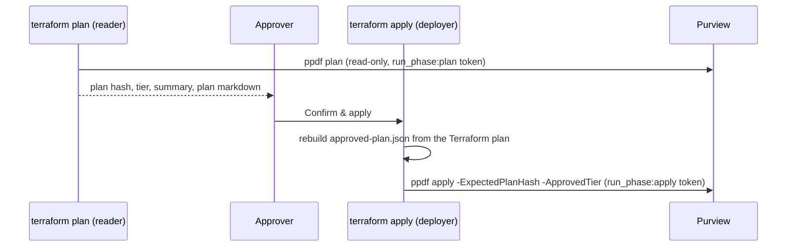

# Terraform adapter

This adapter runs PPDF from Terraform, so teams that standardise on Terraform (HCP Terraform, Terraform Enterprise or the Terraform CLI) get the same plan → approve → apply flow as the Azure DevOps and GitHub adapters.

Purview objects are **not** modelled as Terraform resources. PPDF still does the diffing, the simulation and the safety checks. The tenant is the state. Terraform provides:

- the run.
- the plan review.
- the human gate ("Confirm & apply").
- the run phase that selects the identity.

## How it works

| Phase | Terraform object | What happens |
|---|---|---|
| `terraform plan` | `data.external.ppdf` | Runs `scripts/ppdf-tf-plan.ps1`, which calls `ppdf plan` (or `promote`) as the **reader**. It returns the plan hash, the required approval tier, the action summary, the plan markdown, and the plan document itself as base64. |
| `terraform plan` | `terraform_data.apply` | The resource is replaced whenever the plan hash changes. Preconditions fail the run if the plan has **blocked** actions or needs a **higher tier** than `approved_tier`. |
| Approval | HCP Terraform manual apply | A person with "Apply runs" permission on the workspace reviews the plan output and confirms it. |
| `terraform apply` | `terraform_data.apply` provisioner | Runs `scripts/ppdf-tf-apply.ps1`. It rebuilds the exact plan bytes from the Terraform plan and runs `ppdf apply -ExpectedPlanHash … -ApprovedTier …` as the **deployer** identities. |

Two properties follow from this design:

- **Only the reviewed plan is applied.** The plan bytes and their hash travel inside the Terraform plan. If the bytes change, PPDF refuses to apply (exit 3).
- **Plan and apply can run on different machines.** Nothing has to be carried between phases except the Terraform plan.

When the tenant already matches the configuration, `has_changes` is `false` and the trigger settles to `in-sync`. Terraform then reports no changes.

## Setup (HCP Terraform / Terraform Enterprise)

1. **Create the identities.** Use [`identities/terraform/examples/terraform-cloud`](../../identities/terraform/examples/terraform-cloud/main.tf), then grant the roles with [`identities/powershell`](../../identities/powershell).
   - The reader trusts `run_phase:plan`; each deployer trusts `run_phase:apply`.
   - Use **one workspace per workload** (`purview-prod-dlp`, `purview-prod-retention`, …). Every deployer app trusts the apply-phase token of its own workspace, so a workspace can't mint another workload's deployer token.
2. **Create the workspaces.** For each workload:
   - Set **Apply method** to *Manual apply*.
   - Give **Apply runs** only to that workload's approver team.
   - Add the environment variable `TFC_WORKLOAD_IDENTITY_AUDIENCE` = `api://AzureADTokenExchange`. HCP Terraform then injects `TFC_WORKLOAD_IDENTITY_TOKEN`, which PPDF reads automatically.
3. **Provide PowerShell 7.4+.** The run environment must have it:
   - Use a custom agent image (Agent execution mode), or install `pwsh` before the run.
   - The image also needs the `ExchangeOnlineManagement` (3.8+), `Microsoft.Graph.Authentication` (2.x) and `powershell-yaml` modules. PPDF doesn't install modules itself. The versions pinned in [`.github/actions/setup-ppdf/action.yml`](../../.github/actions/setup-ppdf/action.yml) are the tested set.
4. **Lay out the repository.** Put the framework (pinned to a release tag, for example as a git submodule) and your configuration side by side. Then copy [`examples/basic/main.tf`](examples/basic/main.tf) and set `workloads` and the `cloud` block for each workspace.
5. **Point the environment at the identities.** Copy the client IDs from the `environment_identities` output into `spec.identities` (`reader`, `dlp`, `retention`, `classifier`, `rbac`) in `environments/prod.yml`.

## Module inputs

| Variable | Default | Purpose |
|---|---|---|
| `framework_path` | required | PPDF checkout (contains `cli/ppdf.ps1`). |
| `config_root` | required | Configuration root (contains `environments/` and `artifacts/`). |
| `environment` | required | Environment name (`environments/<name>.yml`). |
| `command` | `plan` | `plan` converges to the configured stage. `promote` moves simulated artifacts to enforcement once the simulation evidence passes. |
| `stage` | `auto` | Applies to `command = plan`: `simulate`, `enforce` or `auto`. |
| `artifacts` / `workloads` | `[]` | Optional scope. Use `workloads` to match the workspace-per-workload layout. |
| `approved_tier` | `standard` | Highest tier the workspace may apply. Raising it is a reviewed code change. |
| `apply_enabled` | `true` | Set to `false` for plan-only workspaces (speculative PR plans, drift checks). |
| `output_path` | `<root>/.ppdf/<env>` | Where plans, results and evidence are written. |
| `pwsh` | `pwsh` | PowerShell executable. |

**Outputs:** `plan_hash`, `has_changes`, `approval_tier`, `approval_environment`, `workloads`, `summary` and `plan_markdown`.

## Day-to-day use

| Goal | How |
|---|---|
| Review a change | Open the run in HCP Terraform and read the `ppdf_plan_markdown` output, plus the PPDF log in the plan log. |
| Simulate first | Set the module's `stage = "simulate"` (or keep `auto`, which deploys new artifacts in simulation). Apply, wait for the soak period, and read the simulation report (`ppdf simulation-report`, or the scheduled GitHub/ADO pipeline). |
| Go live | Run with `command = "promote"` (a separate workspace or a variable change). Promote generates a fresh simulation report and blocks every artifact whose simulation did not pass its thresholds (`simulation.thresholds`, see [lifecycle](../../docs/lifecycle.md#thresholds)). |
| Detect drift | Use a plan-only workspace (`apply_enabled = false`) on a schedule (health assessments or a scheduled speculative run). Any pending change means drift. |
| Higher-risk change | The run fails with "requires 'critical' approval". Raise `approved_tier` in a pull request reviewed by the critical approvers, then re-run. |

## Things to know

- **State contains the plan.** The data source result, including the base64 plan document and markdown, is stored in the plan file and the state. It holds no secrets, but it does describe your DLP and retention configuration. Treat state as sensitive and restrict who can read it.
- **Plan size.** The plan is passed to the apply step in environment-variable chunks of 30,000 characters. Very large tenants should scope each workspace with `workloads` or `artifacts` to keep plans small.
- **Plan age.** `ppdf apply` refuses plans older than `approvals.maxPlanAgeHours` (24 by default). If a run waits too long for confirmation, discard it and start a new one.
- **`terraform destroy` doesn't delete Purview objects.** It only forgets the apply record. To remove an object, set `metadata.ensure: absent` on the artifact (or remove it and set `spec.allowDestructive: true`) and run a normal plan and apply.
- **Failed applies.** A non-zero exit from `ppdf apply` fails the run and taints the resource, so the next run plans again and needs approval again. Partial results are in `<output_path>/apply/apply-result.json`.
- **Terraform CLI without HCP Terraform.** The module works locally too. `terraform plan -out tfplan` is the review artifact and `terraform apply tfplan` is the gate. Sign-in then uses whichever token source is available (see the [identities guide](../../docs/identities.md)), for example a certificate or `PPDF_FEDERATED_TOKEN`.

> **Verify in your tenant:**
> - Whether Microsoft Entra accepts one HCP Terraform workload identity token for several app registrations within a run. The workspace-per-workload layout means each run only needs the reader plus one deployer.
> - Whether your HCP Terraform agent image has outbound access to the Security & Compliance PowerShell endpoints.
